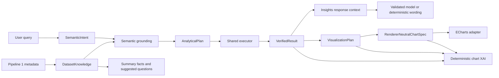

# Pipeline 3 final architecture

Pipeline 3 is a typed, provider-neutral analytical pipeline. Language models may interpret or word verified facts; they do not execute calculations.

## Authoritative components

1. Pipeline 1 supplies dataset context, column semantics, roles, quality metadata, and cleaned data.
2. `SemanticIntent` represents meaning before dataset grounding. The configured `LLMProvider` is attempted first; structural validation rejects invented charts and limits.
3. DatasetKnowledge grounding resolves concepts to typed analytical expressions and controls ambiguity, unresolved concepts, and role/type eligibility.
4. `AnalyticalPlan` is the only executable analytical request contract.
5. `PandasAnalyticalExecutor` is the shared deterministic execution authority.
6. `VerifiedResult` is the source of analytical facts, coverage, warnings, and verification status.
7. Insights sends only bounded verified-result context to optional wording generation. Deterministic validation or fallback remains authoritative.
8. Insights landing derives deterministic `SummaryFact` objects and executable suggested questions, with versioned dataset caching.
9. Visualization intelligence selects or validates a `VisualizationPlan` without recomputing analytical truth.
10. `RendererNeutralChartSpec` carries backend chart intent without ECharts-native fields.
11. The ECharts adapter is the primary browser renderer. The SVG renderer is retained only for missing-ECharts or legacy-payload fallback.
12. Chart XAI derives typed facts from `VerifiedResult`, `VisualizationPlan`, and `ChartSpec`; optional model wording receives selected facts, never source rows.
13. Provider outages, timeouts, malformed output, unsupported analysis, ambiguity, and renderer unavailability degrade to controlled fallbacks or explicit statuses.

## Compatibility boundaries

- Deterministic NLP remains necessary when no provider is configured or the provider fails.
- Legacy grounding is used only when Pipeline 1 column semantics are unavailable and is explicitly signalled.
- Legacy Insights execution is reachable only when no canonical analytical plan is produced; successful canonical plans always use the shared executor.
- The legacy visualization payload is retained for historical suppression/rank compatibility; its chart data is not used by Phase 7+ rendering.
- The legacy request parser/resolver remains available for deterministic/provider-outage compatibility, not as the provider-first primary path.
- The SVG renderer remains an intentional availability fallback.
- `nlp/experimental` V1 and V2 artifacts are research-only, are not imported by production NLP, and are retained with their captured evaluations for reproducibility.

Experimental classification: V1 `schemas.py`, `semantic_interpreter.py`, `grounding.py`, and `evaluator.py` are **ARCHIVE / DEPRECATE**; V2 `schemas_v2.py`, `semantic_interpreter_v2.py`, and `evaluator_v2.py` are **KEEP FOR RESEARCH**. No artifact is currently safe to remove because the directory preserves reproducible migration evidence, while production imports remain isolated from it.

## Observability and privacy

Structured signals identify semantic source, grounding source/outcome, planning status, shared execution/verification, response fallback, visualization source, renderer fallback, and XAI fallback. Logs and model prompts must not contain source dataframes, secrets, provider endpoints, hidden reasoning, or arbitrary executable code. Identifier values are included only when they are explicit verified analytical results required by the request.

## Known limitations

- The configured local `qwen2.5:3b` model has weak zero-shot SemanticIntent accuracy; deterministic validation/fallback contains malformed output but cannot make a schema-valid wrong intent correct.
- Hindi and Hinglish interpretation are inconsistent on the current local model.
- Weak or missing Pipeline 1 semantics increase ambiguity and may require the labelled legacy grounding fallback.
- Advanced chart families remain controlled unsupported XAI cases.
- Currency and unit display depends on supplied metadata; unsupported generated units are rejected.
- Advanced statistical inference, significance testing, nonlinear relationship detection, seasonality, and causal analysis are not implemented.
- Conversations and caches are in-process and are not durable across application restarts.
- Dashboard recommendations are deterministically recomputed on repeated loads; only landing facts/state and XAI facts currently have explicit caches.
