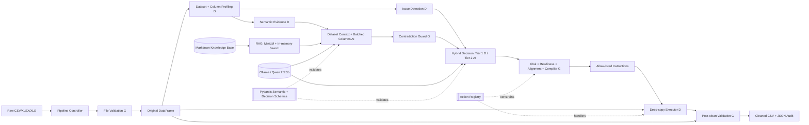

# LYNX Pipeline 1 — Frozen System Architecture

**System version:** `pipeline1_architecture_b_v001`  
**Freeze state:** frozen for the upcoming benchmark (`PIPELINE_FROZEN_FOR_BENCHMARK = True`)  
**Source of truth:** current production path rooted at
`pipelines/pipeline1_cleaning/pipeline.py::run_pipeline1`  
**Scope:** Pipeline 1 only; no frontend, Pipeline 2, database persistence, or benchmark harness

## 1. Architectural statement

Pipeline 1 is a hybrid, safety-gated tabular-cleaning system. Deterministic code
observes a validated dataset and detects candidate quality issues. Local RAG and
Qwen 2.5 through Ollama produce structured semantic understanding and Tier-2
recommendations. Those AI outputs cannot execute transformations. Deterministic
policy, schema validation, semantic/mechanical eligibility checks, an allow-listed
registry, and the instruction compiler control what can reach a deterministic
executor. Execution operates on deep copies, post-clean validation compares the
result with the original, and the exporter writes a new CSV plus a comprehensive
JSON report without overwriting the input.

The architectural boundary is therefore:

> **OBSERVE ≠ UNDERSTAND ≠ DECIDE ≠ AUTHORIZE ≠ EXECUTE ≠ VALIDATE**

## 2. Top-level architecture layers

| # | Frozen layer | Primary responsibility | Principal artifacts |
|---:|---|---|---|
| 1 | **Input & Pipeline Control** | Protect output boundaries, validate and load input, coordinate the run | input path → validation metadata + original `DataFrame` |
| 2 | **Deterministic Observation [D]** | Measure structure/statistics and detect evidence-backed issues | `DatasetProfile`, `DetectedIssue[]`, quality summary |
| 3 | **Semantic Understanding [AI + G]** | Build controlled evidence, retrieve local knowledge, infer dataset/batched-column semantics, reject direct contradictions | `SemanticProfile` with guard audit telemetry |
| 4 | **Hybrid Decision [D + AI]** | Resolve safe Tier-1 cases and request bounded Tier-2 recommendations for unresolved issues | `CleaningDecision[]`, recovery telemetry, warnings |
| 5 | **Deterministic Authorization [G]** | Revalidate semantics and values, enforce risk/review policy and allow-list, compile approved instructions | `CleaningInstruction[]` + skipped/authorization audit |
| 6 | **Deterministic Execution [D]** | Apply registered handlers on deep copies and record exact change lineage | cleaned working `DataFrame`, `ExecutionResult[]` |
| 7 | **Post-clean Validation & Output [G/D]** | Replay/check approved changes, compare before/after, set run status, export artifacts | `ValidationReport`, `cleaned_dataset.csv`, `cleaning_report.json` |

Supporting components sit beside, rather than inside, the main sequence:

- the local Markdown Knowledge Base, embedding model, and in-memory vector store
  support semantic retrieval only;
- the Ollama/Qwen provider supports semantic inference and Tier-2 recommendation,
  but has no connection to the executor;
- Pydantic contracts constrain semantic, decision, instruction, execution, and
  report objects at their respective boundaries.

## 3. Production component inventory

This inventory counts **29 logical production components**. A logical component
is a runtime responsibility with a distinct interface or safety role; tightly
coupled helper functions in one module are grouped where they form one boundary.

| # | Exact component and source | Responsibility | Input → output | Calls/dependencies | Mode and position | Important safety boundary |
|---:|---|---|---|---|---|---|
| 1 | **Pipeline controller** — `pipelines/pipeline1_cleaning/pipeline.py::run_pipeline1` | Coordinates the complete run, keeps the original frame, routes decisions, orders instructions, assembles the report | input/output paths → `Pipeline1Report` and exported artifacts | All Pipeline-1 stages below | [D], Layer 1 spanning all layers | Rejects output paths that would overwrite the source; AI results never bypass controller gates |
| 2 | **Entry file validator** — `ingestion/file_validator.py::validate_file` | Checks existence, regular-file status, extension, nonzero size, readability, rows/columns, duplicate column names | path → validation dictionary | pandas CSV/Excel readers | [G], Layer 1 | Invalid input stops the run before processing; accepts only `.csv`, `.xlsx`, `.xls` |
| 3 | **Dataset loader** — `ingestion/dataset_loader.py::load_dataset` | Loads the validated file into memory and reports basic metadata | validated path → original pandas `DataFrame` + file metadata | pandas | [D], Layer 1 | Reads the source; does not write or mutate it |
| 4 | **Column profiler** — `profiling/column_profiler.py::profile_column` | Computes dtype, nulls, uniqueness, repetition, bounded sample values, and numeric statistics | one `Series` → serializable column profile | pandas, NumPy | [D], Layer 2 | Observation only: no semantic inference or cleaning decision |
| 5 | **Dataset profiler** — `profiling/dataset_profiler.py::profile_dataset` | Aggregates shape, column names, dtype distribution, missingness, exact duplicates, and all column profiles | original `DataFrame` → dataset profile dictionary | Component 4 | [D], Layer 2 | Produces immutable evidence for later reasoning; no mutation |
| 6 | **Issue detector** — `quality/issue_detector.py::detect_issues` | Detects exact duplicates, missing values, non-finite numerics, IQR outlier candidates, whitespace, case variants, rare categories, mixed numeric representations, and mixed date formats | original frame + dataset profile → `DetectedIssue[]` | profiler serialization, `DetectedIssue` schema | [D], Layer 2 | Separates `issue`, `candidate`, and `observation`; detection does not authorize repair |
| 7 | **Quality summarizer** — `quality/quality_report.py::summarize_issues` | Counts issues by type/status, affected columns, and dataset-level issues | `DetectedIssue[]` → quality summary | `DetectedIssue` schema | [D], Layer 2 | Summary is descriptive only |
| 8 | **Semantic evidence builder** — `semantics/evidence_builder.py::build_dataset_evidence` | Selects a compact, controlled subset of profile evidence for semantic reasoning | dataset profile → dataset semantic evidence | Component 5 | [D], Layer 3 | Limits AI input to observed metadata and bounded samples; does not infer meaning |
| 9 | **Knowledge loader/chunker/text builder** — `intelligence/rag/knowledge_loader.py`, `knowledge_chunker.py`, `embedding_text_builder.py` | Loads front-matter-validated Markdown knowledge, splits H2 sections, preserves source/chunk identity, prepares embedding text | `knowledge_base/**/*.md` → traceable knowledge chunks | PyYAML, filesystem | [AI/RAG support], side of Layer 3 | Knowledge is general context, not dataset fact; README/manifest/schema files are excluded from indexing |
| 10 | **Local embedding and vector retrieval subsystem** — `intelligence/rag/embeddings.py`, `vector_store.py`, `retriever.py::RAGRetriever` | Embeds chunks/queries with `all-MiniLM-L6-v2`, indexes them in memory, performs category-filtered cosine search | chunks + semantic query → ranked RAG records | sentence-transformers; Components 8/9 | [AI/RAG support], side of Layer 3 | Retrieval cannot execute actions; provenance fields include source, knowledge ID, chunk ID, category, topic, section, score |
| 11 | **Dataset-level semantic understanding inside Architecture B** — `semantics/batched_analyzer.py::analyze_batched_semantics`, using `semantics/dataset_understanding.py::{retrieve_dataset_context,build_dataset_semantic_prompt}` | Retrieves domain/semantic context and asks the LLM for row entity, probable domain, and dataset description | dataset evidence + RAG context → `BatchedDatasetContext` | Components 8, 10, 13, 14 | [AI], Layer 3 | Prompt declares observed evidence authoritative and RAG generic; failure yields an empty/zero-confidence context and warning |
| 12 | **Architecture-B batched column analyzer** — `semantics/batched_analyzer.py` | Builds compact evidence, batches at most 12 columns, retrieves semantic chunks, requests one structured result per exact name, checks coverage/order, retries once | dataset profile + shared context + RAG → `BatchedColumnSemantic[]` | Components 10, 13, 14 | [AI with deterministic validation], Layer 3 | Missing/duplicate/invented names reject a batch; failed batch becomes per-column `unknown`; no issue detection or cleaning instruction is generated |
| 13 | **Ollama/Qwen structured-generation adapter** — `intelligence/llm/provider.py`, `ollama_provider.py::OllamaProvider` | Sends a Pydantic JSON schema to local Ollama `/api/generate`; validates returned JSON; exposes timing/token metadata | prompt + response model → validated dictionary | local Ollama, default `qwen2.5:3b`, temperature 0, 120 s timeout | [AI], side of Layers 3 and 4 | Only structured objects are returned; invalid/empty responses raise errors; provider never receives an execution API |
| 14 | **Semantic contracts** — `semantics/semantic_schema.py`, `semantics/batched_schema.py` | Defines allowed semantic types, value functions, numeric meanings, dataset context, batched inference, profile warnings and telemetry | model output dictionaries → validated Pydantic objects | Pydantic | [G], control rail for Layer 3 | Closed vocabularies and confidence bounds reject malformed semantic output; the batched prompt requires `semantic_role="unknown"` and the schema defaults to it, although the schema's role field still accepts the broader `SemanticRole` vocabulary |
| 15 | **Semantic contradiction guard and audit** — `semantics/contradiction_guard.py::apply_semantic_contradiction_guard` | Compares full observed columns with inferred types; narrowly corrects direct contradictions and records raw/effective pairs | raw `SemanticProfile` + original frame → effective `SemanticProfile` | existing date parser; Component 14 | [G], end of Layer 3 | Ambiguity, opaque names, binary numeric shape, and low-cardinality numeric shape never override; corrections are capped at 0.75; every original LLM result remains in telemetry |
| 16 | **Tier-1 deterministic decision router** — `decisions/cleaning_decision_engine.py::_tier1` | Resolves whitespace (trim), rare category (no action), outlier/duplicate (review), missing entity reference (review), and missing unknown semantics (insufficient evidence) | issue + effective column semantics → `CleaningDecision` or unresolved issue | Components 6, 15, 19 | [D], Layer 4 | Conservative cases never reach Tier 2; identifiers are not fabricated; rarity/outlier/duplicates are not automatically removed |
| 17 | **Tier-2 batched recommender and recovery** — `decisions/cleaning_decision_engine.py::decide_cleaning`, `_salvage_tier2_response`, `_fallback` | Batches unresolved general and missing issues separately (max 4), requests compact recommendations, salvages valid siblings, retries unresolved pairs/singletons, and falls back per issue | unresolved issues + semantic profile → policy-tagged `CleaningDecision[]`, telemetry, warnings | Components 13, 18, 19 | [AI recommendation + deterministic recovery], Layer 4 | Exact issue-ID coverage; invalid/timeout responses cannot become instructions; valid siblings survive; unresolved issues become high-risk `insufficient_evidence/no_op` |
| 18 | **Missing-value strict recommendation contract, readiness, and alignment validator** — `cleaning_decision_engine.py::{Tier2Missing*Payload,_missing_value_readiness,_validate_missing_value_alignment}` | Supplies redacted readiness facts, requires outcome-specific structured fields, and rejects recommendations contradicting semantic/mechanical evidence | missing issue + semantic profile + observed series + Tier-2 response → accepted or rejected recommendation | Component 20 and imputation preflight | [AI recommendation bounded by G], Layers 4–5 | Median action needs semantic eligibility true, mechanical preflight pass, magnitude/measurement/quantitative type, and no identifier/preservation conflict; no-action needs affirmative preservation evidence |
| 19 | **Decision contracts and deterministic risk/review policy** — `decisions/decision_schema.py::CleaningDecision`; `cleaning_decision_engine.py::_apply_llm_policy` | Validates outcome/action consistency, attaches lineage, caps confidence by semantic confidence, and marks risky LLM actions high-risk/review-required | Tier-1 result or Tier-2 payload → complete `CleaningDecision` | Pydantic | [G], Layers 4–5 | AI supplies a recommendation only; risk/review flags are attached deterministically |
| 20 | **Median semantic eligibility / identifier-shape veto** — `techniques/missing_values.py::assess_median_semantic_eligibility` | Verifies quantitative magnitude semantics and confidence; vetoes identifiers/entity references, ordinal/nominal meanings, and high-cardinality integral label risk | effective semantic result + observed series + issue evidence → tri-state eligibility record | pandas, NumPy | [G], Layer 5 | Numeric shape is veto-only and can never establish measurement meaning; confidence must be at least 0.8 |
| 21 | **Pipeline executable-routing policy** — executable predicate and median adjudication in `pipeline.py` | Separates executable low-risk/no-review actions from skipped decisions; independently rechecks Tier-2 median semantics and mechanical feasibility | `CleaningDecision[]` + original/preview frame → candidate instructions or skip/authorization audit | Components 19, 20, 22 | [G], Layer 5 | Semantic inference and LLM recommendation alone never authorize execution; only explicitly eligible decisions proceed |
| 22 | **Instruction compiler / action validator** — `orchestration/action_validator.py::compile_instruction` | Validates action membership, targets, parameters, dtype, semantic compatibility, full observed-value safety, risk/review state; normalizes parameters | approved `CleaningDecision` → `CleaningInstruction` | registry; date/numeric/imputation assessors | [G], Layer 5 | Rejects unknown/arbitrary actions and unsafe coverage, format, precision, semantic, or missingness conditions |
| 23 | **Allow-listed action registry** — `orchestration/action_registry.py::ACTION_REGISTRY` | Maps six identifiers to code-owned handlers: `no_op`, `trim_whitespace`, `normalize_categorical_labels`, `parse_dates`, `coerce_dtype`, `impute_missing` | validated action ID → deterministic callable | Components 24–26 | [G/D], Layer 5 | The LLM cannot register code or select an arbitrary function; unknown IDs fail closed |
| 24 | **Text/categorical handlers** — `action_registry.py::{trim_whitespace,normalize_categorical_labels}` | Strips only string edges or applies an explicit exact string-to-string mapping | working frame + targets + validated parameters → working frame | pandas | [D], Layers 5–6 | Target/dtype/parameter restrictions; normalization never performs fuzzy or generated remapping |
| 25 | **Date and numeric conversion handlers** — `techniques/date_parsing.py`, `numeric_coercion.py` | Parse explicit date/time formats or convert fully parseable numeric representations with precision/range checks | working series + validated format/dtype → converted series + assessment | datetime, Decimal, pandas | [G/D], Layers 5–6 | ≥95% recognition plus zero locale ambiguity for dates; numeric execution requires 100% safe conversion, rejects leading-zero codes and precision loss |
| 26 | **Missing-value handler** — `techniques/missing_values.py::{validate_imputation_semantics,prepare_imputation,impute_missing}` | Computes replacements from observed values and applies median/mode/controlled constants under strict policy | working series + validated strategy → filled series + imputation audit | Decimal, pandas, Components 18/20 | [G/D], Layers 5–6 | Replacement values are never model inputs; low missingness (≤5%), ≥20 observations for median/mode, dtype/value preservation, and explicit categorical/boolean justification are enforced |
| 27 | **Deterministic executor** — `orchestration/data_cleaner_performer.py::execute_instruction` | Resolves the registered handler, executes on a deep copy, computes changed-cell examples/counts, and records lineage/status | current working frame + `CleaningInstruction` → next working frame + `ExecutionResult` | Component 23 | [D], Layer 6 | Failure returns the pre-instruction copy; source frame remains untouched; no arbitrary generated code path exists |
| 28 | **Post-clean validator** — `validation/post_clean_validator.py::validate_post_clean` | Reprofiles/redetects issues, replays approved transformations, checks row/column scope, dtype, nulls, categories, exact values, and imputation replacements | original + cleaned + before profile + instructions → `ValidationReport` + after profile | Components 4–6, 23–26 | [G], Layer 7 | Detects any change outside approved boundaries; validation occurs before export and controls report success/failure status |
| 29 | **Report assembly and output exporter** — `decisions/decision_schema.py::{Pipeline1Report,ExecutionResult,ValidationReport}`; `output/clean_dataset_exporter.py` | Assembles lineage/audit data and writes new `cleaned_dataset.csv` and `cleaning_report.json` | validated working frame + full report → two output files | JSON, pandas | [D], Layer 7 | Output directory is separate from source; report includes validation failures/warnings rather than hiding them |

## 4. Ordered data and control flow

1. `run_pipeline1(input_path, output_directory)` resolves paths and refuses an
   output target equal to the raw input.
2. `validate_file` returns entry-validation metadata. Failure terminates the run.
3. `load_dataset` creates the **Original DataFrame**. This object remains the
   baseline for execution previews and final validation.
4. `profile_dataset`/`profile_column` create the **Dataset Profile**.
5. `detect_issues` creates **Detected Issues**; `summarize_issues` creates the
   **Quality Summary**.
6. `build_dataset_evidence` creates controlled **Dataset Semantic Evidence**.
7. Architecture B retrieves local knowledge, calls Qwen/Ollama once for shared
   **Dataset Context**, then in ≤12-column batches for **Raw Column Semantic
   Results**. Exact-name coverage is validated and failures are isolated by batch.
8. The contradiction guard combines raw semantics with full-column values and
   returns the **Effective Semantic Profile**. Its telemetry contains the original
   and effective result for every column.
9. The decision engine maps each issue either to a deterministic Tier-1 decision
   or an unresolved Tier-2 queue. General and missing-value queues are separate.
10. Qwen/Ollama produces only **Tier-2 Recommendation Payloads**. Deterministic
    schemas, exact issue-ID matching, missing-value alignment, recovery, and
    fallback turn these into complete **Cleaning Decisions**.
11. The controller applies executable/risk/review policy. Tier-2 median proposals
    additionally require independent semantic eligibility and mechanical
    preflight. Rejections become **Skipped-action / Authorization Audit** entries.
12. `compile_instruction` validates a surviving decision against the action
    registry, semantics, targets, dtypes, and observed values, producing a
    **Cleaning Instruction**. If none survive, a deterministic `no_op`
    instruction is compiled.
13. Instructions run in priority order: `no_op`, whitespace trim, categorical
    normalization, date parsing, numeric coercion, then imputation.
14. `execute_instruction` applies each handler to a deep copy, yielding the next
    **Working/Cleaned DataFrame** and an **Execution Result**.
15. `validate_post_clean` compares original and cleaned states, replays approved
    operations, and emits a **Validation Report**.
16. The controller assembles `Pipeline1Report`, marks status `success` only when
    validation passes and execution warnings are absent, then writes
    **`cleaned_dataset.csv`** and **`cleaning_report.json`**.

### Artifact lineage

```text
Input Path
  → Validation Metadata
  → Original DataFrame
  → Dataset Profile
  → DetectedIssue[] + Quality Summary
  → Dataset Semantic Evidence
  → Raw SemanticProfile [AI]
  → Effective SemanticProfile + contradiction audit [G]
  → CleaningDecision[] [Tier 1 D | Tier 2 AI recommendation]
  → authorization/skipped audit [G]
  → CleaningInstruction[] [G]
  → ExecutionResult[] + Cleaned DataFrame [D]
  → ValidationReport [G]
  → cleaned_dataset.csv + cleaning_report.json
```

## 5. Safety and trust boundaries

### AI boundary

Qwen/Ollama receives controlled profiles, samples, retrieved general knowledge,
issue evidence/examples, and missing-readiness summaries. It emits Pydantic-bound
semantic objects or recommendations. It does **not** receive an execution handle,
write files, register handlers, generate executable cleaning code, or mutate a
DataFrame.

### Semantic boundary

The contradiction guard changes only directly contradicted assignments:

- repeated finite enumerated strings can replace incompatible `text` with
  `categorical`;
- strong explicit date/datetime, UUID, email, or URL patterns can replace an
  incompatible `numeric_measurement` assignment;
- schema-supported corrections are used; URL falls back to `unknown`;
- effective correction confidence is capped at 0.75;
- binary/low-cardinality numeric shape and opaque names cannot trigger change.

The raw LLM semantic object is retained alongside the effective object in
`semantic_profile.telemetry.semantic_contradiction_guard.entries`.

### Decision and authorization boundary

- Tier 1 makes only explicit conservative decisions.
- Tier 2 is a recommendation channel, separated into general and strict
  missing-value contracts.
- Bad batch members do not invalidate valid siblings: unique valid results are
  salvaged and only unresolved IDs are retried/fallbacked.
- Risk/review policy is deterministic and confidence is capped by semantic
  confidence.
- Median imputation passes two independent gates: semantic eligibility and the
  existing mechanical imputation contract. The compiler checks them again.
- High-cardinality integral/weak-repetition shape is a veto against treating a
  possible numeric label as a magnitude; it cannot positively prove a magnitude.

### Execution and preservation boundary

- The registry contains code-authored functions only.
- The compiler rejects actions outside the registry and decisions that do not
  satisfy target, parameter, semantic, dtype, coverage, precision, risk, and
  review conditions.
- Each instruction runs against a deep copy. Handler failure returns the
  pre-instruction copy with an auditable failed `ExecutionResult`.
- The original file is never used as an output path and is never overwritten.
- Post-clean validation independently replays/checks the authorized change set.

## 6. Audit, telemetry, and provenance actually emitted

`cleaning_report.json` contains:

- pipeline version, run ID, status, source path and `raw_dataset_overwritten=false`;
- complete before profile, detected issues, and quality summary;
- effective semantic profile, semantic warnings, LLM/RAG timings and call
  metadata, batch sizes/retries/failures, and contradiction raw/effective audit;
- every cleaning decision with source issue IDs, evidence, semantic basis,
  source (`deterministic_tier1`, `llm_tier2`, `fallback`), confidence, risk and
  review state;
- Tier-2 recovery audit and LLM-call metrics;
- compiler skips, date/numeric/missing assessments, and median authorization
  assessments;
- ordered instructions and per-instruction execution status, changed-cell
  counts/examples, lineage, errors, and imputation metadata;
- the full post-clean validation report and output paths.

There is no production database write, separate audit-log service, or separate
semantic/profile output file in `run_pipeline1`. Semantic/profile metadata is
embedded in `cleaning_report.json`; the second production artifact is the cleaned
CSV.

## 7. Implementation discrepancies from the conceptual architecture

1. **Standalone column understanding is inactive.** The repository contains
   `semantics/column_understanding.py`, but frozen production uses
   `batched_analyzer.py` for Architecture-B column semantics.
2. **Role resolution is inactive.** `semantics/role_resolver.py` exists but is not
   called by `run_pipeline1`; the Architecture-B prompt requires
   `semantic_role="unknown"` for every column. The schema defaults to `unknown`
   but does not enforce that as the only allowed role value.
3. **Authorization is distributed.** There is no single authorization service or
   `ValidatedDecision` object. Authorization is the combination of deterministic
   decision policy, missing readiness/alignment, the controller's executable
   predicate and median adjudication, registry membership, and compilation.
4. **Registry membership is broader than default automatic reachability.** The
   registry implements six actions, but general Tier-2 actions considered risky
   are marked review-required and therefore skipped by the default production
   executable predicate. The special median path can be promoted to low-risk only
   after independent semantic and mechanical authorization; Tier-1 whitespace
   trimming is directly executable. Registry presence alone never authorizes an
   action.
5. **Some decision-schema action names are non-executable.** The recommendation
   schema can express `add_missing_indicator`, `drop_duplicate_rows`, and
   `flag_rows`, but they are absent from `ACTION_REGISTRY`; they cannot compile or
   execute. `flag_rows` represents a review outcome, not a data mutation.
6. **No standalone semantic metadata artifact.** Metadata and semantic audit are
   nested in `cleaning_report.json`.
7. **Validation sets status but does not suppress export.** Validation runs before
   output and determines `success`/`failed`; the exporter still writes the cleaned
   CSV and report so a failed result remains inspectable.
8. **The production model is Qwen 2.5 3B.** Both default semantic and decision
   providers instantiate `OllamaProvider(model="qwen2.5:3b")`; diagnostic models
   used elsewhere are not part of this production diagram.

## 8. Reference topology



This topology is a correctness reference for the paper figure, not the intended
visual style.
